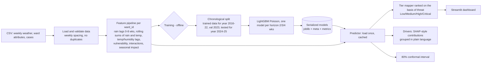

# Architecture: Dengue Early-Warning System

Ward-level dengue risk, 2 to 4 weeks ahead, from lagged weather and ward vulnerability.
Data: 60 wards in 5 cities (Dhaka North/South, Chattogram, Gazipur, Narayanganj), weekly, 2016-01-04 to 2025-12-29.

## 1. Data flow

## 2. Forecast framing and features

For a **forecast origin** week *t* and horizon *h* in {2, 3, 4}, the target is dengue cases in week *t+h*.
Every feature uses data from week *t or earlier* (`shift` and trailing rolling windows only), so a forecast
needs **no weather forecast** and gives the 2-4 week warning window directly.

| Group | Features |
|---|---|
| Multi-week rainfall lags (per `ward_id`) | `rain_lag_0w` ... `rain_lag_8w`, rolling sums over 2/3/4/6/8 weeks, 4-week max |
| Temperature, humidity | lags at 0/2/4 weeks, rolling means over 4 and 8 weeks, 4-week mean night temperature |
| Ward vulnerability | `water_logging_risk_index`, `sanitation_score`, `population_density_sqkm`, interactions (rain x water-logging, rain x density, poor sanitation x water-logging) |
| Season, city | sine/cosine of origin week and target week, city code |

Exploration supports the breeding clock: correlation of weekly cases with rainfall peaks at a **3-week lag**
(about 0.75, versus 0.53 for same-week rain) and weekly cases peak in July-September, after the June-September rains.

Tests (`tests/test_features.py`) verify lags against hand calculation, that lags never cross wards, that **changing
future weather does not change earlier features** (no leakage), the target offset, and split ordering.

## 3. Chronological validation split

Split by **forecast-origin date**, never randomly:

| Period | Dates | Use |
|---|---|---|
| Train | 2016-01-04 to 2022-12-31 | fit models, derive tier thresholds |
| Validation | 2023 | early stopping, conformal interval calibration |
| Test | 2024-01 to 2025-12 | final reported metrics, never used for fitting or tuning |

A random split would let the model see weeks after the ones it predicts and overstate accuracy.
The deployed model is refit on train + validation (same iteration count x 1.15). Reported metrics come from the
train-only model on the untouched test period.

## 4. Model selection rationale

- **LightGBM with Poisson objective**: weekly case counts are non-negative, skewed and 58% zeros; Poisson loss
  fits that. Trees capture non-linear lag effects and ward x rain interactions on 31k rows, train in a few seconds per horizon, and
  serialize to about 0.4 MB.
- **One model per horizon** (2, 3, 4 weeks) instead of one multi-output model: simpler, each is tuned by its own early stopping.
- **Baselines on the test period** (MAE, cases/week): ward historical mean 3.10; last observed week 1.69 / 1.92 / 2.14 (2/3/4 wk).
  Model: **1.00 / 1.03 / 1.25**.
- **Ablation**: adding past case counts as features gives MAE 1.00 / 1.02 / 1.25, no gain, so the deployed model uses
  **weather, ward and season only**, matching the brief and avoiding dependence on case reporting delays.
- Deep learning was rejected: small tabular data, higher cost, no accuracy case.

**Risk tiers** come from train-period quantiles of weekly cases (75th, 90th, 96th percentile): Low < 4, Medium 4-8,
High 9-13, Critical >= 14 cases per ward-week. Predicted expected cases are mapped to a tier.

**Test results** (2024-2025):

| Horizon | MAE | RMSE | Tier accuracy | Within 1 tier | High/Critical recall | 80% interval coverage |
|---|---|---|---|---|---|---|
| 2 wks | 1.00 | 1.97 | 84.8% | 98.9% | 56% | 80.8% |
| 3 wks | 1.03 | 1.98 | 84.1% | 98.7% | 54% | 80.4% |
| 4 wks | 1.25 | 2.42 | 82.4% | 97.5% | 54% | 82.6% |

Limitation: expected-value forecasts are pulled toward the mean on noisy counts, so about half of High/Critical weeks are
under-called by one tier (98%+ are within one tier). Treat Medium plus a high upper interval bound as a watch signal.

## 5. Interpretability and uncertainty

- **Drivers**: tree contributions (`pred_contrib`, SHAP-style) per prediction, summed into plain groups (recent rainfall,
  temperature, humidity, ward vulnerability, season) and shown as % effect on expected cases, plus top individual factors with real values.
- **Intervals**: split-conformal 80% intervals from validation residuals, by predicted-size bin (test coverage 80-83%).

## 6. Compute and API cost controls

| Control | Detail |
|---|---|
| Serialized models | Trained offline (`python -m src.train`, about 18 s), saved with joblib (1.3 MB total); app never trains |
| Load once | `st.cache_resource` loads models and builds the feature table once per process (0.3 s startup) |
| Vectorized features | grouped pandas `shift`/`rolling`, no row loops |
| Batch + cache | all 60 wards predicted in one call (about 17 ms for 60 wards x 3 horizons); results cached per (date, horizon) |
| No API calls | inference uses only the supplied dataset: **0 external API calls, 0 LLM calls, 0 tokens** |
| If a live weather API is added later | cache by (location, date), refresh at most once per day, fall back to last cached value |
| Measured | `models/benchmark.json`: single-ward prediction with drivers about 9 ms |

## 7. Production notes (for the onsite round)

Modules are separable (`features`, `train`, `predict`, `tiers`, `app`). Lag windows, horizons, split dates and tier
quantiles live in `src/config.py`; retraining on new data is one command.
